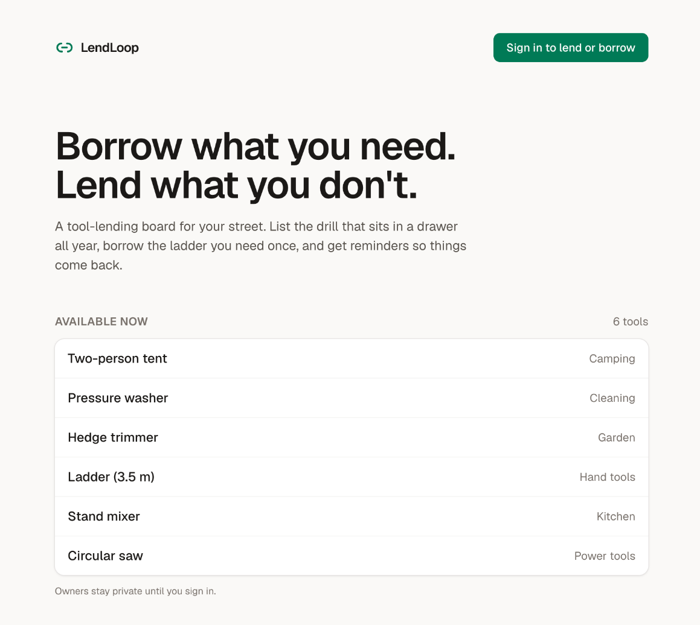
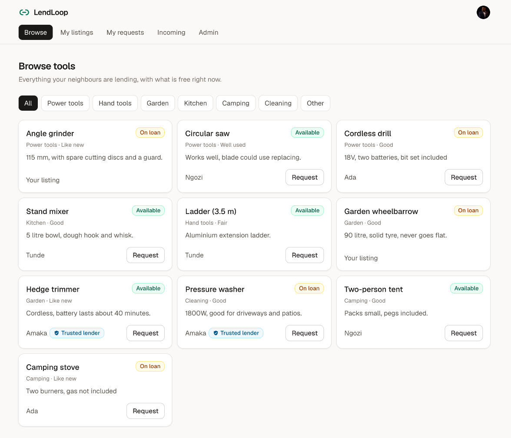
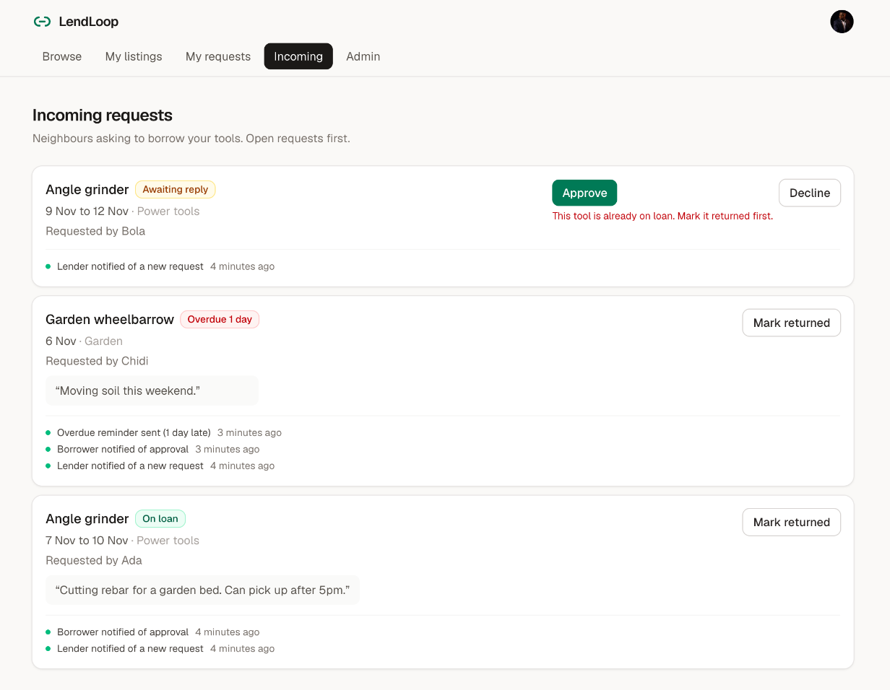
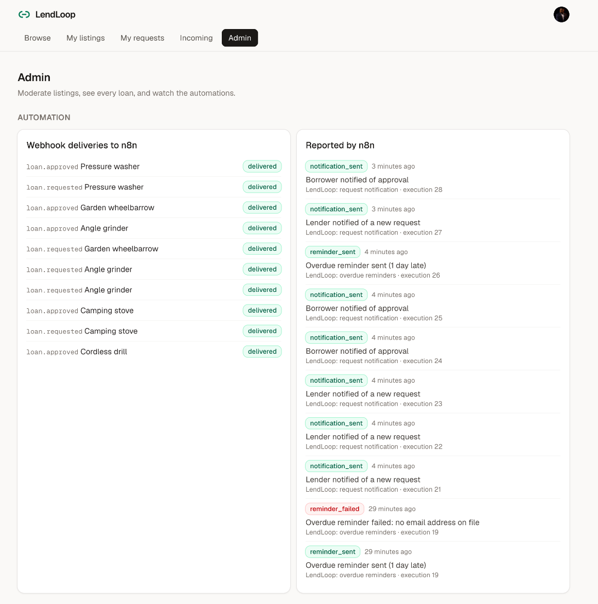
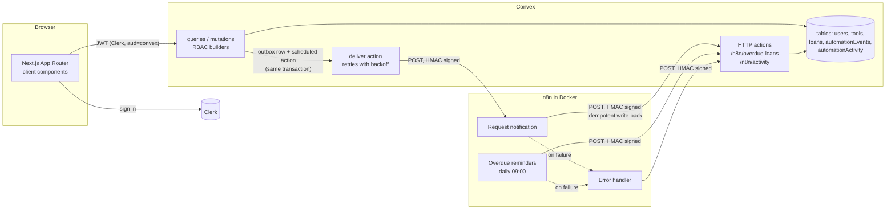

# LendLoop

**Borrow what you need. Lend what you don't.**

A neighbourhood tool-lending board. Neighbours list the drill that sits in a drawer all year, borrow the ladder they need once, and get notified and reminded by n8n workflows so things actually come back.

Built with Next.js 16 (App Router), Clerk, Convex, n8n (self-hosted in Docker) and TypeScript.

<p align="center">
  
  
  
  
</p>

---

## Contents

1. [What it does](#what-it-does)
2. [Architecture](#architecture)
3. [Local setup](#local-setup)
4. [Environment variables](#environment-variables)
5. [Authorization (RBAC)](#authorization-rbac)
6. [The n8n integration](#the-n8n-integration)
7. [Security and data minimisation](#security-and-data-minimisation)
8. [Testing and verification](#testing-and-verification)
9. [Running it in production](#running-it-in-production)
10. [Trade-offs and what I'd do next](#trade-offs-and-what-id-do-next)

---

## What it does

**Public page (`/`)**: a read-only list of tools that are available right now, name and category only, pulled from Convex. No owner details. A "Sign in to lend or borrow" button opens Clerk.

**Signed in**

| View | What you can do |
|---|---|
| Browse | Every listed tool with its availability, filterable by category. Request a tool for a date range, with an optional note for the owner. |
| My listings | List, edit and remove your tools (name, category, condition, short description). |
| My requests | Track what you asked to borrow, cancel a pending request, see notifications and reminders sent about it. |
| Incoming | Approve or decline requests on your tools, mark a loan as returned. Open requests first. |
| Admin | Remove any listing, see every loan, mark a lender as "Trusted Lender", watch webhook deliveries and workflow failures, retry a failed delivery. |

Every loan card shows its recent automation activity, for example "Borrower notified of approval · 5 minutes ago" or "Overdue reminder sent (2 days late) · 2 days ago", plus deliveries that are queued, retrying or failed.

**Loan lifecycle**

```
pending ──approve──▶ approved ──mark returned──▶ returned
   │                   (tool is on loan; endDate is the due date)
   ├──decline──▶ declined
   └──cancel───▶ cancelled   (borrower only)
```

Approving hands the tool over: it shows "On loan" until the owner marks it returned, and only one loan per tool can be active. A loan is overdue when it is approved and its end date has passed.

---

## Architecture



**Why this shape**

- **Convex holds all business rules.** The Next.js app is a thin client: every read and write is a Convex query or mutation, and every one of them checks who is calling. The UI hides buttons you cannot use, but that is a convenience, not the security boundary.
- **Clerk owns identity, Convex owns authorization.** Clerk issues a JWT; Convex validates it against the Clerk issuer and maps it to a row in its own `users` table. Roles and the Trusted Lender flag live in that row, never in the token.
- **n8n owns delivery and scheduling**, not business logic. It decides how to tell someone, Convex decides what happened and who should know. n8n never reads the database; it gets exactly one event, or one list of overdue loans, at a time.

**Code map**

```
app/
  page.tsx                 public board
  (app)/layout.tsx         signed-in shell, nav, ensures a Convex user row exists
  (app)/browse|listings|requests|incoming|admin/page.tsx
components/                ui primitives, LoanCard, activity list, badges
convex/
  schema.ts                tables and indexes
  lib/auth.ts              userQuery/userMutation/adminQuery/adminMutation + ownership asserts
  lib/outbox.ts            enqueueLoanEvent (transactional outbox)
  lib/hmac.ts              sign / verify (Web Crypto, constant-time verify)
  users.ts tools.ts loans.ts   the public API
  automation.ts            webhook delivery, retries, overdue query, idempotent write-back
  http.ts                  signed HTTP endpoints for n8n
  seed.ts                  demo data (internal)
  *.test.ts                convex-test suites
n8n/workflows/*.json       exported workflows (no secrets inside)
docker-compose.yml         n8n
scripts/                   import workflows, run the overdue job now, send signed test requests
proxy.ts                   Clerk route protection (Next 16 renamed middleware to proxy)
```

---

## Local setup

**Prerequisites:** Node 20+, pnpm, Docker. Free accounts on [Clerk](https://clerk.com) and [Convex](https://convex.dev).

### 1. Install

```bash
pnpm install
```

### 2. Clerk

1. In the Clerk dashboard, create an application (email sign-in is enough).
2. **API keys**: copy the publishable and secret keys into `.env.local`:
   ```
   NEXT_PUBLIC_CLERK_PUBLISHABLE_KEY=pk_test_...
   CLERK_SECRET_KEY=sk_test_...
   ```
3. Open the **Convex integration** page in the Clerk dashboard (dashboard.clerk.com/apps/setup/convex) and activate it. This creates the `convex` JWT template and shows your **Frontend API URL** (looks like `https://your-app-12.clerk.accounts.dev`). You need it in step 3.

### 3. Convex

```bash
pnpm convex
```

Log in when prompted and create a project. **Choose a local deployment** when asked: the Convex backend then runs on your machine and can call n8n on `localhost` directly. (A cloud dev deployment works too, but it cannot reach `localhost:5678`; see [Using a Convex cloud deployment](#using-a-convex-cloud-deployment).) This writes `CONVEX_DEPLOYMENT`, `NEXT_PUBLIC_CONVEX_URL` and `NEXT_PUBLIC_CONVEX_SITE_URL` to `.env.local`. Leave it running.

In a second terminal, generate the two integration secrets and set the deployment's environment:

```bash
openssl rand -hex 32   # use as CONVEX_TO_N8N_SECRET
openssl rand -hex 32   # use as N8N_TO_CONVEX_SECRET
```

```bash
npx convex env set CLERK_JWT_ISSUER_DOMAIN https://your-app-12.clerk.accounts.dev
npx convex env set N8N_REQUEST_WEBHOOK_URL http://localhost:5678/webhook/lendloop-request-event
npx convex env set CONVEX_TO_N8N_SECRET <first secret>
npx convex env set N8N_TO_CONVEX_SECRET <second secret>
```

> No Convex account handy? `CONVEX_AGENT_MODE=anonymous npx convex dev` starts an anonymous local backend with no login (Convex marks it beta).

### 4. n8n

```bash
cp n8n/.env.example n8n/.env
```

Put the **same two secrets** in `n8n/.env`, plus an encryption key (`openssl rand -hex 24`). Then:

```bash
pnpm n8n:up        # docker compose up -d
pnpm n8n:import    # imports the three workflows, publishes them, restarts n8n
```

The editor is at http://localhost:5678. The first visit asks you to create a local owner account; it never leaves your machine.

### 5. Run the app

```bash
pnpm dev
```

Open http://localhost:3000, sign in, and you are a regular user.

**Optional demo data** (three neighbours, six tools):

```bash
npx convex run seed:demo
```

**Make yourself an admin** (after signing in once):

```bash
npx convex run users:setRole '{"email":"you@example.com","role":"admin"}'
```

This is an internal mutation. It can only be run with the deployment's admin key (CLI or dashboard), never from a browser.

### Using a Convex cloud deployment

Convex cloud cannot reach `localhost`. Expose n8n with a tunnel and point Convex at it:

```bash
cloudflared tunnel --url http://localhost:5678
npx convex env set N8N_REQUEST_WEBHOOK_URL https://<random>.trycloudflare.com/webhook/lendloop-request-event
```

and set `CONVEX_SITE_URL=https://<deployment>.convex.site` in `n8n/.env`, then `docker compose up -d` again.

---

## Environment variables

**Next.js (`.env.local`)**

| Name | Purpose |
|---|---|
| `NEXT_PUBLIC_CONVEX_URL` | Convex client URL (written by `npx convex dev`) |
| `NEXT_PUBLIC_CONVEX_SITE_URL` | Convex HTTP actions URL (written by `npx convex dev`) |
| `CONVEX_DEPLOYMENT` | Which deployment the CLI targets (written by `npx convex dev`) |
| `NEXT_PUBLIC_CLERK_PUBLISHABLE_KEY` | Clerk publishable key |
| `CLERK_SECRET_KEY` | Clerk secret key, used by `proxy.ts` on the server |

**Convex deployment (`npx convex env set`)**: these live in Convex, not in any file.

| Name | Purpose |
|---|---|
| `CLERK_JWT_ISSUER_DOMAIN` | Clerk Frontend API URL. Convex only accepts JWTs from this issuer with `aud=convex`. |
| `N8N_REQUEST_WEBHOOK_URL` | n8n webhook for request notifications |
| `CONVEX_TO_N8N_SECRET` | Signs webhooks Convex sends to n8n |
| `N8N_TO_CONVEX_SECRET` | Verifies requests n8n sends to Convex |

**n8n (`n8n/.env`, loaded by docker-compose)**

| Name | Purpose |
|---|---|
| `CONVEX_TO_N8N_SECRET` | Verifies Convex's webhooks |
| `N8N_TO_CONVEX_SECRET` | Signs n8n's calls to Convex |
| `CONVEX_SITE_URL` | Base URL of Convex HTTP actions as seen from the container |
| `N8N_ENCRYPTION_KEY` | Encrypts n8n's credential store at rest |

`.env*` files are gitignored; `.env.example` and `n8n/.env.example` document them.

---

## Authorization (RBAC)

Two roles, stored on the Convex `users` row:

| | user | admin |
|---|---|---|
| Browse, request, cancel own request | yes | yes |
| Create, edit, delete **own** listings | yes | yes |
| Approve, decline, mark returned on **own** tools | yes | yes |
| Remove **any** listing | no | yes |
| View all loans, members, automation | no | yes |
| Mark a Trusted Lender | no | yes |
| Grant the admin role | no | no (CLI / dashboard only) |

**How it is enforced, in Convex functions**

1. **Authentication and role are applied by construction.** Every public function is built from one of four builders in `convex/lib/auth.ts`: `userQuery`, `userMutation`, `adminQuery`, `adminMutation` (custom functions from `convex-helpers`). The builder resolves the caller from the verified JWT, loads their `users` row, rejects them if missing (or not admin), and hands the handler `ctx.user`. A handler cannot forget to authenticate, because there is no unauthenticated variant to reach for except the deliberately public `tools.listPublic`.
2. **Ownership is checked against the document being touched.** `assertToolOwner`, `assertLender` and `assertBorrower` compare `ctx.user._id` with the stored `ownerId` / `borrowerId`. The client never says who owns what; it only sends ids.
3. **Roles are never taken from the client or the token.** New users are always created as `user`. The only path to `admin` is the internal `users:setRole` mutation, which is not part of the public API at all.
4. **State transitions are guarded too.** You cannot approve a declined request, approve while the tool is out, or borrow your own tool. Each check throws a typed `ConvexError` (`UNAUTHENTICATED`, `FORBIDDEN`, `NOT_FOUND`, `INVALID`, `CONFLICT`) that the UI shows as a message.
5. **Read paths follow the same rules.** "My requests" and "Incoming" only query by the caller's own id through an index, so there is no filter to get wrong. Other users' emails are never returned to non-admins.

`proxy.ts` (Next 16's renamed middleware) redirects signed-out visitors away from app routes. It is an optimistic check that saves an empty page load, not authorization.

---

## The n8n integration

### Workflow 1: Request notification

`n8n/workflows/1-request-notification.json`

```
Webhook (raw body) → Verify signature → valid? ─yes→ Respond 202 → Compose notification
                                              └no──→ Respond 401          → Send notification (mock)
                                                                           → Sign write-back
                                                                           → Record in LendLoop (POST /n8n/activity, retries)
```

**Convex side.** Every mutation that changes a loan (request, approve, decline, cancel, mark returned, listing removed) calls `enqueueLoanEvent`, which inserts an `automationEvents` row and schedules the `deliver` action, **in the same transaction as the state change**. This is the transactional outbox pattern: if the mutation rolls back, no event exists; if it commits, delivery is guaranteed to be attempted. There is no "saved the loan but the webhook call threw" gap.

`deliver` builds a minimal payload, signs it, and POSTs to n8n with a 10 second timeout. On failure it reschedules itself with backoff (5 s, 30 s, 2 min, 10 min). After five attempts the event is marked `failed`, logged, and shown in the admin view with a Retry button and on the loan card itself.

**The payload** is everything n8n needs to notify one person, and nothing else:

```json
{
  "eventId": "j97...",
  "type": "loan.approved",
  "occurredAt": "2026-11-07T15:03:12.000Z",
  "loan": { "id": "jd7...", "toolName": "Cordless drill", "startDate": "2026-11-07", "endDate": "2026-11-10" },
  "recipient": { "userId": "jn7...", "firstName": "Bola", "email": "bola@example.com", "role": "borrower" }
}
```

Who is notified: the lender for `loan.requested` and `loan.cancelled`, the borrower for `approved`, `declined` and `returned`.

**n8n side.** The webhook takes the raw body so the signature is checked over the exact bytes Convex signed, not re-serialised JSON. It answers `202` as soon as the signature is valid, so Convex's delivery status means "n8n accepted it", and slow notification work never holds Convex's request open. The notification is a mock email: the workflow logs it (masked address) to the container output and writes `notification_sent` back to Convex, which is what the loan card shows.

### Workflow 2: Overdue reminders

`n8n/workflows/2-overdue-reminders.json`

```
Schedule (daily 09:00) ┐
Run now (manual) ──────┴→ Sign query → Fetch overdue loans (POST /n8n/overdue-loans, retries)
                          → One item per loan → Send reminder (mock, per item)
                          → Sign status → Write status to LendLoop (POST /n8n/activity, retries)
```

Convex's `/n8n/overdue-loans` returns approved loans past their end date that have **not** had a reminder recorded today, each with a ready-made idempotency key `reminder:<loanId>:<YYYY-MM-DD>`. For each one the workflow sends a reminder and writes the status back:

- `reminder_sent` with key `reminder:<loanId>:<date>`
- `reminder_failed` with key `reminder:<loanId>:<date>:failed` (for example, a borrower with no email address). One bad borrower is recorded and skipped; the rest of the run continues.

Run it now instead of waiting for 09:00: `pnpm n8n:overdue`.

### Workflow 3: Error handler

`n8n/workflows/3-error-handler.json`, set as the **error workflow** of the other two.

When a run fails (after node-level retries are exhausted), the Error Trigger fires. It logs `WORKFLOW FAILED` with the execution id to the container output and reports `workflow_failed` to Convex (key `workflow_failed:<workflowId>:<executionId>`), so the failure shows in LendLoop's admin view. Failed executions are also kept in n8n (`saveDataErrorExecution: all`).

If Convex itself is down, the error report fails too, but the failure is still visible in two places: the container log line and n8n's execution list. Nothing fails silently.

### Reliability summary

| Failure | What happens |
|---|---|
| n8n down or slow when a loan changes | Convex retries with backoff over about 13 minutes, then marks the event failed; visible on the loan and in admin, retryable |
| Convex retries a webhook n8n already processed | Same `eventId`, so the write-back is a duplicate and no second record is created |
| Write-back to Convex fails transiently | HTTP node makes up to 3 tries, 3 s apart; the request is identical each time, so retries are safe |
| Write-back still fails | Run fails, error workflow logs and reports it |
| Notification cannot be sent (no address) | Workflow 1 fails into the error workflow; workflow 2 records `reminder_failed` and continues |
| Daily job re-run, or retried, on the same day | Convex leaves out loans already reminded today, and the write-back key dedupes anyway |
| Forged, tampered or replayed-late request | Rejected with 401 by whichever side receives it |

### Idempotency

The write-back endpoint (`automation.recordActivity`) looks up the idempotency key in an index and inserts only if it is absent. Because Convex mutations are serialisable transactions, two concurrent requests with the same key cannot both insert: one commits, the other is retried by Convex, sees the row, and returns `{"status":"duplicate"}`. In FOKiiS, my production SaaS, I enforce the same guarantee for Paystack webhooks with Redis idempotency keys (`SET NX` with a 24 hour TTL, keyed on the Paystack event id), because there the database write and the dedupe check live in different systems. Here Convex gives the check and the insert in one transaction, so no extra store is needed.

---

## Security and data minimisation

**Signing in both directions.** Both Convex → n8n and n8n → Convex requests carry:

```
X-LendLoop-Timestamp: <unix seconds>
X-LendLoop-Signature: v1=<hex HMAC-SHA256 of "<timestamp>.<raw body>">
```

- **Two secrets, one per direction.** A leaked n8n secret cannot be used to forge events into n8n from "Convex", and vice versa.
- **The timestamp is inside the signature**, and requests older than five minutes are rejected, so a captured request cannot be replayed later. Within the window, replays hit idempotency keys and change nothing.
- **Raw-body verification.** n8n verifies over the raw bytes; Convex verifies `req.text()` before parsing.
- **Constant-time comparison.** Convex uses `crypto.subtle.verify`; n8n uses `crypto.timingSafeEqual` after a length check.
- **Endpoint binding.** Every body names its `action` (`activity.record`, `loans.listOverdue`), and each endpoint rejects any other, so a body signed for one endpoint cannot be replayed against another.
- **Strict validation after the signature.** Write-backs go through an internal mutation with Convex argument validators; an unknown `kind` or an unknown loan id is a 400, not a stray row.

This is the same scheme I built for Paystack webhook verification in FOKiiS (HMAC-SHA512 over the raw body, verified before anything is parsed or trusted), extended with a timestamp because here I control both sides and can add replay protection that Paystack's scheme does not have.

**Secrets.** Kept in Convex deployment env vars and in `n8n/.env`, which docker-compose passes to the container. The exported workflow JSON reads them as `$env.CONVEX_TO_N8N_SECRET` / `$env.N8N_TO_CONVEX_SECRET`; no secret value appears in any workflow file or in the repo. (n8n Code nodes cannot read n8n's credential store, which is why the HMAC keys come from the container environment; see production notes for the managed-secrets version.) `.env*` files are gitignored.

**Data minimisation**

| Who | Sees |
|---|---|
| Anonymous visitor | Tool name and category, available tools only. No owner, no description, no ids. |
| Signed-in neighbour | Tool details, the owner's first name and Trusted Lender badge. Never an email. |
| Lender | The borrower's first name and their note, on requests for the lender's own tools only. |
| Borrower | The lender's first name and Trusted Lender badge, on the borrower's own requests only. |
| Admin | Adds member emails, for moderation. |
| n8n, request event | One recipient's first name and email, tool name, dates, event type. No notes, no descriptions, nothing about the other party. |
| n8n, overdue list | Per loan: tool name, due date, days overdue, borrower first name and email. Nothing about the lender. |
| Logs | Mock notifications log a masked address (`b***@example.com`). |

Names are stored as first names only. The request note stays in Convex and is shown only to the lender.

**Other hardening.** n8n is published on `127.0.0.1` only. Text inputs are trimmed and length-limited on the server, not only in the form. Loan date ranges are validated server-side (real calendar dates, not in the past, at most 30 days). Removing a listing is a soft delete so loan history survives.

---

## Testing and verification

```bash
pnpm test        # 21 convex-test cases: RBAC, lifecycle, payload minimisation, idempotency, HMAC, HTTP endpoints
pnpm typecheck
pnpm lint
```

The tests call the real exported Convex functions in an in-memory Convex backend, with identities like the ones Convex derives from a Clerk JWT. They cover, among others: a user editing or deleting someone else's listing, a borrower approving their own request, an unrelated user declining or returning, a lender cancelling a borrower's request, plain users calling admin functions (all loans, members, automation overview, Trusted Lender), and anonymous writes. Each is expected to be rejected with the right error code.

**Calling a Convex function directly as the wrong user**, against a running backend:

```bash
npx convex run loans:approve '{"loanId":"<someone else's request>"}' \
  --identity '{"subject":"user_chidi","issuer":"https://demo.clerk.test","name":"Chidi","email":"chidi@example.com"}'
# → ConvexError {"code":"FORBIDDEN","message":"Only the owner of this tool can do that."}
```

**Signed requests by hand** (`scripts/signed-request.mjs` signs exactly like Convex and n8n do, reading the secret from `n8n/.env`):

```bash
# Replay: send the identical signed webhook three times. One notification record results.
node scripts/signed-request.mjs --url http://localhost:5678/webhook/lendloop-request-event \
  --env-file n8n/.env --secret-env CONVEX_TO_N8N_SECRET --body '<event json>' --times 3

# Tampered body or stale timestamp → 401
node scripts/signed-request.mjs ... --tamper
node scripts/signed-request.mjs ... --age 600

# Forced failure: an event whose recipient has no email fails "Compose notification"
# and lands in the error workflow, which reports workflow_failed to Convex.
```

---

## Running it in production

What I would change before real neighbours used it:

**Secrets and keys**
- Move the HMAC secrets into a secrets manager (n8n external secrets with Vault / AWS Secrets Manager / GCP Secret Manager, Convex env vars set from CI) and rotate them. Support two active secrets per direction during rotation (verify against either, sign with the new one).
- Turn off `N8N_BLOCK_ENV_ACCESS_IN_NODE=false` once secrets come from external secrets, so Code nodes no longer see the container environment.
- Clerk production instance, its own `CLERK_JWT_ISSUER_DOMAIN`, Convex production deployment.

**n8n**
- Run n8n on a managed host or a small VM with Postgres instead of SQLite, behind HTTPS with a real domain (no tunnel), queue mode with a Redis-backed worker for throughput, and a pinned image updated deliberately.
- Restrict the webhook path by IP allowlist or a gateway in front of it, on top of the HMAC check.
- Replace the mock sender with a real provider (Resend, Postmark, SES, WhatsApp Business API) and pass the idempotency key as the provider's `Idempotency-Key` header. Today the system is at-least-once for sending: if n8n sends an email but its write-back is lost, a retry could send it again. The provider-side key closes that gap and makes delivery effectively exactly-once.
- Send error-workflow alerts to a person (Slack or email) as well as Convex.

**Convex and the app**
- Paginate the lists (`usePaginatedQuery`) instead of the fixed caps (200 tools, 100 requests) that are fine for a street but not for a city.
- Add a cron that alerts when events stay `failed`, and prune old `automationEvents`.
- Store each user's time zone and compute "today" per borrower for reminders. Today loan dates are calendar dates and "overdue" uses the UTC date, with one day of grace when picking a start date.
- Rate-limit request creation per user (convex-helpers rate limiter) to stop request spam.
- Sync users from Clerk webhooks (user.updated, user.deleted) so profile changes and account deletion propagate, and add a data export and deletion path.
- Observability: Convex log streams to a log platform, n8n execution metrics, alerting on failed-event counts.
- CI running typecheck, lint and tests on every PR; preview deployments per branch.

---

## Trade-offs and what I'd do next

- **Approval means handover.** I treat approving as handing the tool over, so availability is one stored field that the board and filters read through an index. The alternative, a booking calendar with future reservations, is more realistic but turns availability into a date-window computation on every read. I would add reservations as the next feature, with overlap checks in the approve mutation.
- **Overdue is computed when queried.** Convex queries that read the clock do not re-run as time passes, so an "Overdue" badge appears on the next data change or page load rather than at midnight exactly. The reminders job is unaffected because it asks fresh each run.
- **Activity summaries come from n8n.** The loan card shows the summary text n8n writes back (length-capped, rendered as text). That keeps message wording in the workflow where it belongs, at the cost of trusting n8n for display text, which the signature already establishes.
- **Users are created on first sign-in** by a mutation the client calls, rather than a Clerk webhook. It is simpler to run locally and good enough until profile changes and deletions need to propagate (see production notes).
